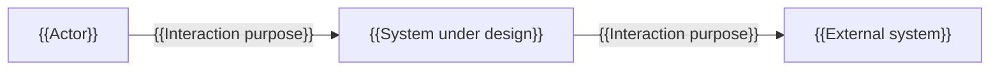
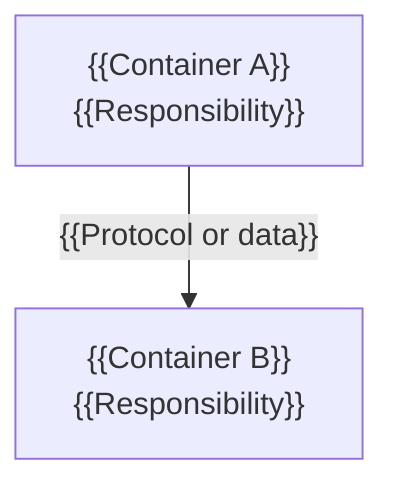
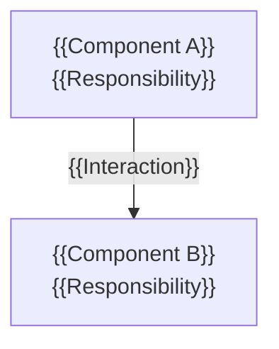

# Architecture Overview (Template)

| Field | Value |
| --- | --- |
| Asset type | Reusable framework template. Not a project document and not a filled example. |
| Purpose | Skeleton for an Architecture Overview used in Phase 3 (System Design and Architecture) to describe context, components, integration boundaries, data ownership, views, key decisions, and non-functional considerations. |
| Status | Approved |
| Version | 0.1.3 |
| Last updated | 2026-11-10 |
| Owner role | Documentation Agent |
| Authority / approval | Approved by Human user on 2026-11-10. |
| Validation | PASS — independent validation completed; findings HIGH, MEDIUM and LOW resolved. |
| Applies to | Architecture overviews stored under `docs/03-architecture/`. |
| Related documents | [`framework/standards/documentation-standards.md`](../standards/documentation-standards.md); [`architecture-decision-record.md`](./architecture-decision-record.md); [`software-requirements-specification.md`](./software-requirements-specification.md). |

**Change history**

| Version | Date | Summary | Reason | Author | Status |
| --- | --- | --- | --- | --- | --- |
| 0.1.3 | 2026-11-10 | Updated metadata to reflect independent validation PASS, status `In review`, and pending human approval. | Record the completed independent validation result without approving the template. | Documentation Agent | Approved by Human user on 2026-11-10. |

---

## How to use this template

1. Copy everything from the *Project document skeleton* marker into the target file under `docs/03-architecture/`.
2. Replace every `{{ ... }}` placeholder and remove all italic guidance notes and HTML comments.
3. Describe the architecture as documentation, never as implementation: no source code, executable artefacts, infrastructure code, or deployment automation may appear in this document.
4. Keep every diagram reproducible from text, and pair it with a textual description that can be reviewed without the diagram. If a diagram and its description disagree, record the conflict instead of assuming which is correct.
5. Reference decisions rather than restating them. Each architecturally significant choice belongs in an `ADR-NNN` record.
6. Classify anything not established by a requirement or an approved decision. A design proposal is `RECOMMENDATION` until it is accepted.
7. Do not present an architecture as approved, selected, or validated without a recorded approval.

**Identifier scope.** Non-standard prefixes used in this template (`ADR`, `CMP`, `ASM`, `OQ`, `DEC`) are document-local register identifiers, not requirement prefixes defined by the documentation standard. Where the same item type appears in more than one document, the project must allocate a single project-wide sequence (see `documentation-standards.md` §5.4) so that the same identifier is not assigned to different items.

**Placeholder convention.** `{{ ... }}` marks a value to be supplied. Italic notes (`*Guidance: ...*`) and HTML comments (`<!-- ... -->`) are instructions to the author and are removed from the finished document. No text in this skeleton is confirmed project information.

---

<!-- ===== BEGIN PROJECT DOCUMENT SKELETON ===== -->

# {{System name}} — Architecture Overview

| Field | Value |
| --- | --- |
| Purpose | {{What this overview explains and which design or delivery decisions it supports.}} |
| Status | {{Draft / In review / Approved / Superseded / Withdrawn}} |
| Version | {{0.1.0}} |
| Last updated | {{YYYY-MM-DD}} |
| Owner role | {{Responsible role}} |
| Authority / approval | {{Who authorized this document; `Not approved` if the architecture has not been approved.}} |
| Related documents | {{Requirements specification, decision records, integration specifications, security architecture, data model, deployment architecture.}} |

## 1. Purpose and scope

{{The architecture that is described, the level of detail, and the intended audience.}}

**Addressed in this overview:** {{...}}

**Not addressed in this overview:** {{aspects covered by other documents, with references}}

*Guidance: name the requirements revision this architecture responds to. An architecture overview that does not state which requirements it satisfies cannot be assessed for fitness.*

## 2. Architectural context

### 2.1 System boundary

{{What is inside the system boundary, what is outside it, and who or what interacts across it.}}

| Element | Inside or outside | Interaction with the system | Classification | Source |
| --- | --- | --- | --- | --- |
| {{Actor or external system}} | {{Outside}} | {{Interaction}} | {{Label}} | {{Requirement or decision reference}} |

### 2.2 Context view (C4 Level 1)

**Textual description of the context view.** {{Restate, in reviewable prose, every element and relationship shown above, including direction and purpose. The description must agree with the diagram.}}

*Guidance: replace the Mermaid placeholder labels and relationships. Keep the description sufficient to review the view without rendering the diagram.*

## 3. Components and responsibilities

### 3.1 Container view (C4 Level 2)

**Textual description of the container view.** {{Restate each container, its responsibility, and each relationship with its direction and mechanism.}}

### 3.2 Component view (C4 Level 3)

{{Describe the internal decomposition of the containers for which component detail is material, or state "Not applicable" with the reason if this level is not required.}}

**Textual description of the component view.** {{Restate each component, its responsibility, and its interactions.}}

*Guidance: do not decompose every container. Include only the views that support a decision or a review.*

### 3.3 Component register

| ID | Component or container | Responsibility | Owns data | Interfaces exposed | Related requirements |
| --- | --- | --- | --- | --- | --- |
| `CMP-001` | {{Name}} | {{Single primary responsibility}} | {{Data entities, or None}} | {{INT-00N or internal interface}} | {{FR-00N, NFR-00N}} |

*Guidance: identifier scheme used here: `CMP-NNN`. A component with no traceable requirement or technical constraint needs a justification or should not be present.*

## 4. Integration boundaries

| ID | Boundary | Participants | Direction | Mechanism or contract | Data crossing the boundary | Trust boundary | Status |
| --- | --- | --- | --- | --- | --- | --- | --- |
| {{INT-00N}} | {{Boundary name}} | {{Internal component and external party}} | {{Inbound / Outbound / Bidirectional}} | {{Documented contract, with reference}} | {{Data or None}} | {{Crosses a trust boundary: yes or no, with basis}} | {{Defined / Proposed / Undefined — see open questions}} |

*Guidance: reference the integration specification for contract detail rather than duplicating it. An undefined mechanism must remain an `OPEN QUESTION`, not an implied design choice.*

## 5. Data ownership and flows

| Data entity | Owner component | Consumers | Sensitivity | Lifecycle or retention basis | Classification | Source |
| --- | --- | --- | --- | --- | --- | --- |
| {{Entity}} | {{CMP-00N}} | {{CMP-00N, external parties}} | {{Classification assigned by the project}} | {{Basis, or Undefined — see open questions}} | {{Label}} | {{Requirement or decision}} |

*Guidance: one authoritative owner per data entity. Where ownership is disputed between components or documents, record the conflict rather than choosing silently.*

## 6. Key architecture decisions

| Decision ID | Title | Status | Requirements or constraints addressed | Summary of the decision |
| --- | --- | --- | --- | --- |
| `ADR-001` | {{Title}} | {{Proposed / Accepted / Rejected / Superseded / Deprecated}} | {{FR-00N or No supporting requirement — reason}} | {{One-sentence summary; detail belongs in the record}} |

*Guidance: identifier scheme used here: `ADR-NNN`. Reference the decision record path. A decision without a supporting requirement or constraint is a defect and must be reported.*

## 7. Non-functional considerations

| Requirement | Architectural response | Evidence or rationale | Status | Classification |
| --- | --- | --- | --- | --- |
| {{NFR-00N}} | {{How the architecture addresses it}} | {{Analysis, measurement, or reference}} | {{Addressed / Partially addressed / Not addressed}} | {{Label}} |

*Guidance: do not claim that a quality target is met unless it has been demonstrated. Design intent and verified achievement are different statements.*

## 8. Security considerations

| Requirement or concern | Architectural control | Boundary or asset protected | Residual risk | Status |
| --- | --- | --- | --- | --- |
| {{SEC-00N}} | {{Control description}} | {{Asset or boundary}} | {{Residual risk, or Not assessed}} | {{Addressed / Partially addressed / Not addressed}} |

*Guidance: refer to the security architecture document for control detail. Do not invent regulatory or compliance obligations; cite the source or record an `OPEN QUESTION`.*

## 9. Deployment notes

{{Deployment-relevant structure at an architectural level: environments, placement of containers, and operational constraints.}}

| Aspect | Statement | Classification | Source or decision |
| --- | --- | --- | --- |
| {{Aspect, for example environment separation}} | {{Statement}} | {{Label}} | {{ADR-00N or source}} |

*Guidance: keep this at architectural level. Deployment procedures, scripts, and infrastructure implementation are out of scope for this system.*

## 10. Assumptions

| ID | Assumption | Basis | Impact if wrong | Verification path and owner | Status |
| --- | --- | --- | --- | --- | --- |
| `ASM-001` | {{Assumption}} | {{Basis}} | {{Affected components or decisions}} | {{How and by whom it will be verified}} | {{Open / Verified / Invalidated — with authority}} |

*Guidance: identifier scheme used here: `ASM-NNN`.*

## 11. Open questions

| ID | Question | Why it matters | Owner / resolver | Needed by | Blocking for phase gate | Status |
| --- | --- | --- | --- | --- | --- | --- |
| `OQ-001` | {{Question}} | {{Affected views or decisions}} | {{Role}} | {{Date or milestone}} | {{Yes / No — decided by the Software Architect}} | {{Open / Resolved — with resolution}} |

*Guidance: identifier scheme used here: `OQ-NNN`. Undefined interfaces, unresolved data ownership, and undecided technology selections belong here.*

## 12. Decisions and approval status

| ID | Decision | Approving role | Approval date | Status | Evidence |
| --- | --- | --- | --- | --- | --- |
| `DEC-001` | {{Decision, for example approval of the architecture described here}} | {{Human role}} | {{YYYY-MM-DD or Pending}} | {{Proposed / Approved / Rejected / Superseded}} | {{Recorded approval reference}} |

**Statement of approval status.** {{State which parts of the architecture are accepted, which remain proposals, and which depend on unresolved open questions.}}

*Guidance: an architecture overview may describe accepted decisions, but it does not accept them. Approval authority remains with the human user, presented by the Software Architect.*

## 13. References

| Reference | Purpose | Location |
| --- | --- | --- |
| {{Document or source}} | {{What it supports}} | {{Repository-relative path, section anchor, or URL with access date}} |

## 14. Change history

| Version | Date | Summary | Reason | Author | Status |
| --- | --- | --- | --- | --- | --- |
| {{0.1.0}} | {{YYYY-MM-DD}} | {{Summary of the change}} | {{Reason}} | {{Author role}} | {{Draft / In review / Approved / Superseded / Withdrawn}} |

<!-- ===== END PROJECT DOCUMENT SKELETON ===== -->
